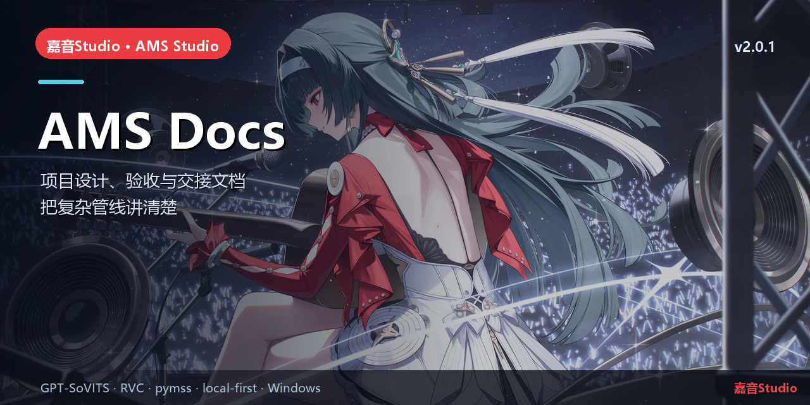

# AMS Docs

> 设计、验收、发布与交接文档 · 让复杂管线可复用


## 简介

嘉音Studio 的工程文档仓库：总体设计、插件/启动器/Gateway 方案、阶段计划、验收记录、事故复盘与 v2.0 GPT-SoVITS 重构资料。
文档会标注“当前”与“历史快照”，当前状态以根仓库 `CURRENT_STATE.md` 与 Release 为准。

## 核心能力

- 总体架构、数据布局、模块设计。
- TTS 重构：P0 对照、runtime、Gateway、UI、Agent 与验收报告。
- 发布记录：H2 → H5 → v1.1 → v2.0.0 → v2.0.1。
- 安全规约、事故复盘、交接清单。

## 本仓库

```text
05_新方案探讨/   调研与 DSH 证据
06_方案设计/     模块设计
07_执行计划/     阶段计划
10_事故后盘点/   事故与恢复
handoff-20261026/ 旧交接快照（历史）
```

## 快速开始

从根 `README.md` 或 `CURRENT_STATE.md` 开始；历史快照会明确标注。

## 相关链接

- 总仓库：[yan-mc/AMS-Studio](https://github.com/yan-mc/AMS-Studio)
- 最新发布：[yan-mc/ams-release releases](https://github.com/yan-mc/ams-release/releases)
- 当前版本：**嘉音Studio v2.0.1**（feed 2058）
- 文档：[ams-docs](https://github.com/yan-mc/ams-docs)

## 说明

- 所有音乐数据默认留在安装目录 `data/`；Gateway 只监听 `127.0.0.1`。
- 本项目为本地优先工具，不提供云端上传；使用第三方模型/音频时请遵守各自许可。
- License: 文档内容归项目所有；引用第三方资料遵循原许可。
